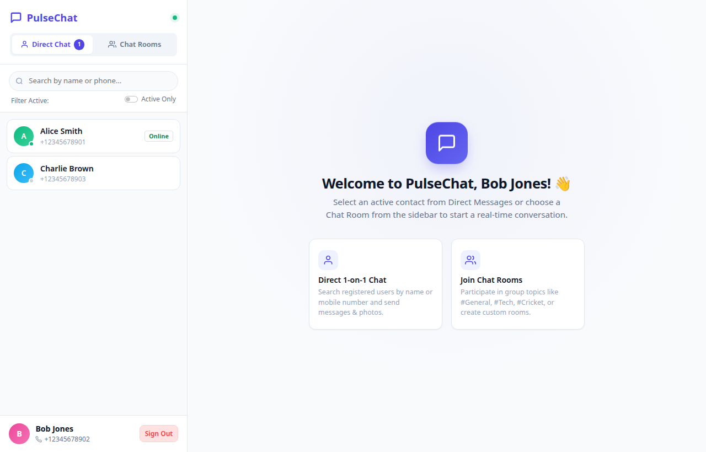
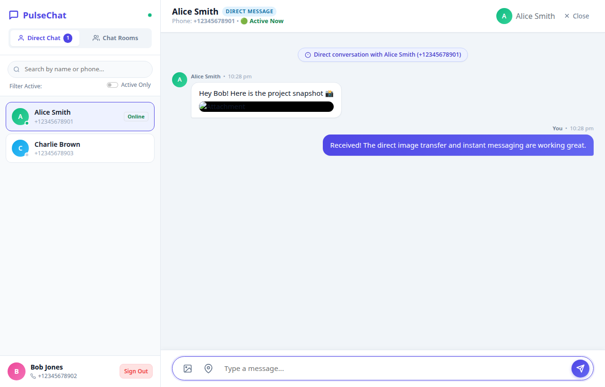
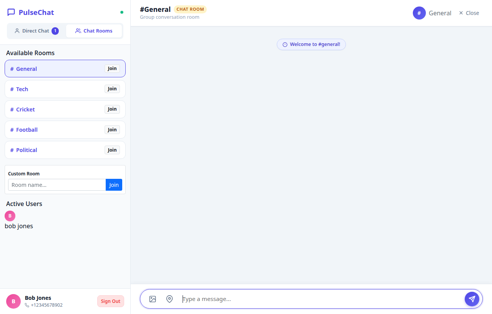
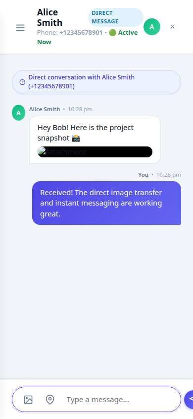

# Chat App (PulseChat)

A modern, real-time messaging platform featuring **Direct 1-on-1 Chat**, **Chat Rooms**, **Image Sharing**, **Phone Number Authentication**, and a persistent local database. Built with **Node.js**, **Express**, **Socket.IO**, and **Handlebars (hbs)**.

---

## Table of Contents
- [Screenshots](#screenshots)
- [Overview](#overview)
- [Key Features](#key-features)
- [Architecture & Local Database](#architecture--local-database)
- [Project Structure](#project-structure)
- [Prerequisites](#prerequisites)
- [Installation & Setup](#installation--setup)
- [Environment Configuration](#environment-configuration)
- [Running the Application](#running-the-application)
- [API & Socket Events Reference](#api--socket-events-reference)
- [Testing](#testing)
- [Changelog & Features Log](#changelog--features-log)

---

## Screenshots

### 1. Phone Number Authentication (Sign-Up / Login)
Modern authentication flow requiring only **Full Name** and **Phone Number** on sign-up, and **Mobile Number only** for existing users to sign in. Features real-time phone validation, uniqueness enforcement, and toast alerts.


---

### 2. Welcoming Screen (Zero-State Experience)
Before selecting a contact or room, the right panel presents a welcoming screen with quick action cards instead of an orphaned message input bar and send button.



---

### 3. Direct 1-on-1 Messaging & Image Sharing
Clear UI separation for Direct Messages: search active/registered users, online presence indicators, inline image transfer, and profile icon showing your name and phone number.



---

### 4. Dedicated Chat Rooms
Easily join available chat rooms (`#General`, `#Tech`, `#Cricket`, `#Football`, `#Political`) or create custom rooms with live active user presence.



---

### 5. Mobile Responsive View
Offcanvas slide-out sidebar, responsive drawer, docked bottom input bar with image attachment, and touch-optimized controls.

<p align="center">
  
</p>

---

## Overview
PulseChat is an instant messaging system providing clear separation between **Direct 1-on-1 Messages** and **Group Chat Rooms**:
1. **Simplified Phone Authentication**: Users register with their Phone Number and Name. Phone numbers are validated and unique across the user base.
2. **Local User Database**: Registered users are persisted locally in `data/users.json`, enabling direct search and messaging without requiring users to join the same room first.
3. **Active User Search & Direct Chat**: Search registered users by name or phone, filter for currently online users, and exchange text, location, and images directly.
4. **Image Sharing**: Send and receive photos directly in 1-on-1 conversations with preview staging and inline card display.
5. **Separate Chat Rooms**: Join preset or custom chat rooms for multi-user discussions.
6. **Profile Badge**: User profile shows their avatar initial, full name, and phone number at the bottom of the sidebar.

---

## Key Features

- **Phone Number Validation & Uniqueness**: Validates E.164 phone numbers (7 to 15 digits) and prevents duplicate registrations.
- **Local JSON Database (`data/`)**: Self-contained persistent database for users (`data/users.json`) and direct chat messages (`data/direct_messages.json`).
- **Real-Time Presence Tracking**: Dynamic online/offline green status indicators showing active connected users.
- **Image Upload & Sharing**: File picker with preview staging bar, server-side storage in `/uploads/`, and responsive inline image cards.
- **Dual Mode UI**: Seamless tab switching between **Direct Chat** and **Chat Rooms**.
- **Geolocation Sharing**: Native browser Geolocation API with single-click Google Maps links.
- **Mobile-First Responsive Layout**: Drawer navigation on small screens with smooth backdrop dismiss.

---

## Architecture & Local Database

```text
├── data/
│   ├── users.json             # Persistent local user store (id, name, phoneNumber, createdAt)
│   └── direct_messages.json   # 1-on-1 message history (fromUserId, toUserId, text, imageUrl, timestamp)
└── public/
    └── uploads/               # Stored image attachments served via Express
```

- When a user signs up, their profile is stored in `data/users.json`.
- When users exchange direct messages or images, the history is persisted in `data/direct_messages.json` so conversations reload on reconnect.
- Real-time active socket mapping tracks multi-tab connections and updates presence indicators (`online` / `offline`).

---

## Project Structure
```text
chat-app/
├── package.json               # Dependencies and test runner script
├── .env                       # Environment configuration (PORT, NODE_ENV)
├── .env.example               # Example template for environment settings
├── data/                      # Local persistent JSON database
│   ├── users.json
│   └── direct_messages.json
├── src/
│   └── index.js               # Express app, REST endpoints, and Socket.IO real-time hub
├── utils/
│   ├── db.js                  # Database manager, phone validation, user search & message history
│   ├── message.js             # Message object formatter with timestamps
│   └── user.js                # In-memory room socket memberships & presence tracking
├── public/
│   ├── assets/
│   │   └── bootstrap/         # Bootstrap styles and scripts
│   ├── css/
│   │   └── style.css          # Design system with direct chat & room styles
│   ├── js/
│   │   └── chat.js            # Client-side Socket.IO handler, DM switching & image staging
│   ├── uploads/               # Uploaded images directory
│   ├── views/
│   │   ├── index.hbs          # Phone number + name registration view
│   │   └── chat.hbs           # Main dashboard with direct chat, rooms & profile bar
│   └── images/
│       └── screenshots/       # High-resolution screenshots of the UI
├── scripts/
│   └── populate-and-capture.js # Screenshot generator script with headless Chrome
└── tests/
    ├── db.test.js             # Unit tests for database, phone validation & search
    ├── direct-chat.test.js    # Integration tests for direct messaging & image uploads
    ├── server.test.js         # Integration tests for HTTP endpoints and room events
    └── utils.test.js          # Unit tests for user and message utilities
```

---

## Prerequisites
- **Node.js**: v18.x or v20.x+
- **npm**: v8.x or v10.x+

---

## Installation & Setup

1. **Clone the repository:**
   ```bash
   git clone https://github.com/saaash25/chat-app.git
   cd chat-app
   ```

2. **Install dependencies:**
   ```bash
   npm install
   ```

---

## Environment Configuration

Configure environment settings in `.env` in the root directory (refer to `.env.example`):
```env
PORT=3000
NODE_ENV=development
```

---

## Running the Application

### Development Mode (with hot-reload)
```bash
npm run dev
```

### Production Mode
```bash
npm start
```

Navigate to:
```text
http://localhost:3000
```

---

## API & Socket Events Reference

### REST Endpoints
| Method | Endpoint | Body / Query | Description |
|---|---|---|---|
| `POST` | `/api/auth/signup` | `{ name, phoneNumber }` | Registers a new user with unique phone. |
| `POST` | `/api/auth/login` | `{ phoneNumber, name }` | Authenticates existing user or creates profile. |
| `GET` | `/api/users/search` | `?q=...&activeOnly=true` | Searches registered users with online status. |
| `GET` | `/api/direct-messages` | `?userId1=...&userId2=...`| Fetches conversation history between 2 users. |
| `POST` | `/api/upload` | `{ imageBase64 }` | Uploads an image and returns static `/uploads/...` URL. |

### Socket.IO Events
| Event | Direction | Payload | Description |
|---|---|---|---|
| `auth` | Client &rarr; Server | `{ userId, name, phoneNumber }` | Registers user socket for direct chat presence. |
| `searchUsers` | Client &rarr; Server | `{ query, activeOnly }` | Searches active users via WebSocket. |
| `sendDirectMessage` | Client &rarr; Server | `{ toUserId, text, imageUrl, location }` | Sends 1-on-1 direct message or photo. |
| `receiveDirectMessage` | Server &rarr; Client | `messageObject` | Delivers direct message in real-time. |
| `getDirectHistory` | Client &rarr; Server | `{ withUserId }` | Retrieves saved conversation history. |
| `userPresenceChanged` | Server &rarr; Client | `{ userId, isOnline }` | Broadcasts user connect / disconnect status. |
| `join` | Client &rarr; Server | `{ username, room, userId }` | Joins a group chat room. |
| `sendMessage` | Client &rarr; Server | `messageText` | Broadcasts text to room members. |
| `sendLocation` | Client &rarr; Server | `locationUrl` | Broadcasts coordinates to room members. |

---

## Testing

Run the automated test suite using Node.js's built-in test runner:
```bash
npm test
```

### Test Coverage (42 passing tests across 19 suites)
- **`tests/db.test.js`**:
  - Phone number validation (international, local, whitespace stripping)
  - Rejection of invalid phone numbers
  - Display name validation
  - User registration and phone uniqueness verification
  - User search by name or phone
  - Direct message & image persistence in JSON DB
- **`tests/direct-chat.test.js`**:
  - REST authentication (`/api/auth/signup`, `/api/auth/login`)
  - Mobile-only login for existing users and 404 validation for unknown numbers
  - Image upload endpoint (`/api/upload`)
  - Real-time direct message and photo exchange over Socket.IO
  - Active user search and online status filtering
- **`tests/server.test.js`**:
  - HTTP endpoints (`/`, `/chat`, static assets)
  - Room joining, welcome event, and user presence list
  - Real-time room text broadcast and location sharing
  - Disconnect handling and room synchronization
- **`tests/utils.test.js`**:
  - Room user management and active socket presence tracking
  - Message formatting and timestamp generation

---

## Changelog & Features Log

### Bug Fixes & Refinements (Latest Update)
1. **Mobile-Only Login Flow**:
   - For existing users, only the mobile number is required to log in; the Name field is completely hidden on the Login tab.
   - Registration tab retains both Full Name and Phone Number inputs with full validation.
2. **Replaced Browser Alerts with Custom Toasts**:
   - Eliminated all native browser `alert()` popups in both `index.hbs` and `chat.hbs`.
   - Built a sleek, non-blocking toast notification system (`showToast(message, type)`) supporting `success`, `error`, `warning`, and `info` with smooth animations and dismiss triggers.
3. **Welcoming Screen Empty State**:
   - Eliminated the awkward default state where an empty message input and send icon were visible on the right panel before any contact or room was selected.
   - Introduced a welcoming hero screen with quick feature cards guiding the user to start a direct chat, search contacts, or join a room.
   - Added a close conversation button in the chat header to quickly return to the welcoming screen.
4. **Loading & Race Condition Fixes**:
   - Handled initial contact list loading states and fixed empty search results flicker.
   - Added debounced user searching (200ms) for high-performance live user filtering.
   - Added live socket connectivity indicator in the sidebar header to reflect real-time network states.

### Core Features Log
1. **Phone Number Sign-Up Flow**:
   - Replaced username + room landing page with Phone Number & Full Name registration.
   - Added E.164 phone number validation and uniqueness enforcement.
2. **Persistent Local Database (`utils/db.js`)**:
   - Implemented JSON database in `data/users.json` and `data/direct_messages.json`.
   - Users can search and message any registered user directly without being in a chat room.
3. **Direct 1-on-1 Messaging**:
   - 1-on-1 real-time messaging between users.
   - Live presence indicators (`🟢 Active Now` / `⚪ Offline`).
   - Filter active users only switch.
4. **Direct Image Sharing**:
   - File attachment selector with thumbnail preview and staging bar.
   - Server-side storage in `/uploads/` and inline image cards.
5. **Clear UI Separation (Direct Messages vs Chat Rooms)**:
   - Sidebar tab switcher between `Direct Chat` and `Chat Rooms`.
   - Dynamic headers distinguishing direct conversations from room broadcasts.
6. **Profile Bar**:
   - Dedicated profile bar displaying avatar icon, full name, and phone number (`+1234567890`) with Sign Out button.
7. **Complete Test Suite**:
   - 42 automated tests passing with 0 failures (`npm test`).
