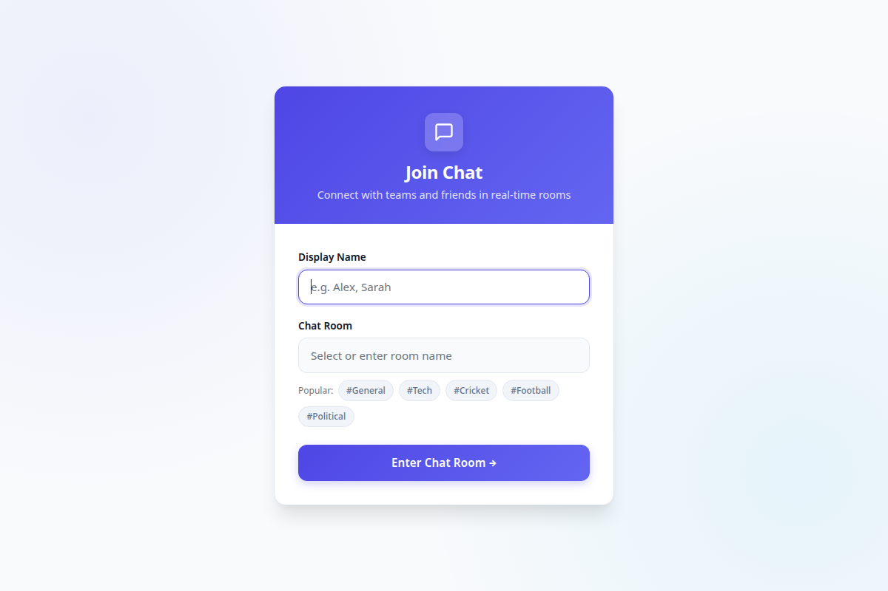

# Chat App (PulseChat)

A modern, real-time multi-room chat application built with **Node.js**, **Express**, **Socket.IO**, and **Handlebars (hbs)**, featuring a contemporary, responsive UI design.

---

## Table of Contents
- [Screenshots](#screenshots)
- [Overview](#overview)
- [Features & UI Improvements](#features--ui-improvements)
- [Project Structure](#project-structure)
- [Prerequisites](#prerequisites)
- [Installation & Setup](#installation--setup)
- [Environment Configuration](#environment-configuration)
- [Running the Application](#running-the-application)
- [Socket Events Reference](#socket-events-reference)
- [Testing](#testing)
- [Bug Fixes & Modernization Log](#bug-fixes--modernization-log)

---

## Screenshots

### 1. Join Chat Landing Page
Modern card layout with interactive quick-join room chips (`#General`, `#Tech`, `#Cricket`, `#Football`, `#Political`) and smooth input focus rings.



---

### 2. Real-Time Chat Room (Desktop View)
Sleek full-height viewport with active user presence sidebar, glowing connection status, avatar color generation, distinct sender/receiver bubbles, and system event pills.


---

### 3. Mobile Responsive View
Seamless layout adaptation for mobile viewports featuring a slide-out drawer sidebar, compact headers, and docked action bar.

<p align="center">
  
</p>

---

## Overview
PulseChat is an instant messaging platform enabling synchronized real-time conversations across partitioned rooms. Users can:
- Join any preset room or create custom rooms instantly.
- Send and receive real-time messages with low latency via WebSockets.
- Share geolocation coordinates with single-click Google Maps links.
- Monitor active room membership with dynamic join/leave notifications and online counts.

---

## Features & UI Improvements

### Modern Design Standards
- **Contemporary Palette**: Sophisticated indigo & slate color system (`--primary: #4f46e5`, `#f8fafc` backdrops).
- **Glassmorphism & Gradients**: Subtle gradients on headers, buttons, and self-message bubbles for visual hierarchy.
- **Dynamic User Avatars**: Deterministically generated circular initial avatars with individualized color accents.
- **Micro-Interactions**: Hover elevation, button transitions, and a pulsating live status indicator (`.pulse-indicator`).
- **Responsive Offcanvas Sidebar**: Full desktop sidebar that transforms into an offcanvas drawer with backdrop overlay on mobile devices.
- **Interactive Quick-Pick Chips**: One-click pills to quickly select popular rooms on the landing page.
- **Dedicated Location Cards**: Formatted geolocation shares with Google Maps pin icons and clean action buttons.

---

## Project Structure
```text
chat-app/
├── package.json               # Project metadata, dependencies, and test scripts
├── .env                       # Environment configuration (PORT, NODE_ENV)
├── .env.example               # Example template for environment settings
├── src/
│   └── index.js               # Express application, HTTP server, and Socket.IO events
├── utils/
│   ├── message.js             # Message payload generator with timestamps
│   └── user.js                # In-memory user store and room membership helpers
├── public/
│   ├── assets/
│   │   └── bootstrap/         # Bootstrap styles and scripts
│   ├── css/
│   │   └── style.css          # Modern custom design system and layout styling
│   ├── js/
│   │   └── chat.js            # Client-side Socket.IO interactions and UI state
│   ├── views/
│   │   ├── index.hbs          # Join room landing view
│   │   └── chat.hbs           # Main chat interface with message feed & sidebar
│   └── images/
│       └── screenshots/       # High-resolution screenshots of the UI
├── scripts/
│   └── populate-and-capture.js # Screenshot generator script with headless Chrome
└── tests/
    ├── utils.test.js          # Unit tests for user management and message utilities
    └── server.test.js         # Integration tests for HTTP endpoints and Socket.IO events
```

---

## Prerequisites
- **Node.js**: v18.x or v20.x+
- **npm**: v8.x or v10.x+

---

## Installation & Setup

1. **Clone the repository:**
   ```bash
   git clone https://github.com/saaash25/chat-app.git
   cd chat-app
   ```

2. **Install dependencies:**
   ```bash
   npm install
   ```

---

## Environment Configuration

Configure environment settings in `.env` in the root directory (refer to `.env.example`):
```env
PORT=3000
NODE_ENV=development
```

- `PORT`: Port on which the HTTP & WebSocket server listens (defaults to `3000` or fallback `3001`).
- `NODE_ENV`: Runtime environment (`development` / `production`).

---

## Running the Application

### Development Mode (with hot-reload)
```bash
npm run dev
```

### Production Mode
```bash
npm start
```

Once started, open your browser and navigate to:
```text
http://localhost:3000
```

---

## Socket Events Reference

### Client to Server
| Event | Payload | Callback Response | Description |
|---|---|---|---|
| `join` | `{ username, room }` | `(error)` | Joins the specified room. |
| `sendMessage` | `messageText` | `({ error, message })` | Broadcasts text message to users in room. |
| `sendLocation` | `locationUrl` | `({ error, message })` | Broadcasts location URL to users in room. |

### Server to Client
| Event | Payload | Description |
|---|---|---|
| `welcome` | `messageObject` | Welcome message sent directly to joined user. |
| `joinMessage` | `messageObject` | Notification broadcast to other room members. |
| `receiveMessage` | `messageObject` | Chat message from another user in the room. |
| `receiveLocation` | `messageObject` | Location link from another user in the room. |
| `roomData` | `{ usersList }` | Updated list of active users in the room. |
| `disconnectMessage`| `messageObject` | Notification when a user leaves the room. |

---

## Testing

Run unit and integration tests using Node.js's built-in test runner:
```bash
npm test
```

### Test Coverage (24 passing tests)
- **`utils/user.js`**:
  - Adding users with whitespace trimming and case-insensitivity
  - Input validation against missing, empty, or non-string inputs
  - Rejection of duplicate usernames within the same room
  - Allowing identical usernames in different rooms
  - Removing users on socket disconnection
  - Finding users by socket ID
  - Case-insensitive room queries and safe handling of invalid arguments
- **`utils/message.js`**:
  - Message formatting, timestamp generation, and parameter defaults
- **`tests/server.test.js` (End-to-End & Integration)**:
  - HTTP routes (`/`, `/chat`, and static Bootstrap assets)
  - Socket.IO connection and `join` handshake
  - Direct `welcome` event and `roomData` presence list
  - Duplicate user rejection and error handling
  - Real-time text message broadcast (`sendMessage` -> `receiveMessage`)
  - Geolocation sharing broadcast (`sendLocation` -> `receiveLocation`)
  - Empty message rejection and validation
  - Disconnect notifications and room list synchronization

---

## Bug Fixes & Modernization Log

1. **Modern UI Redesign (`public/css/style.css`, `public/views/`)**:
   - Replaced outdated color scheme and rigid Bootstrap tables with a modern CSS variables design system.
   - Built full-height flex layout (`100vh`) with custom message scroll area and floating input bar.
   - Designed responsive offcanvas sidebar for mobile devices with backdrop dismiss.
   - Added interactive room chips on the join page for quick room selection.
   - Created distinct chat bubble styles for self vs others with dynamic color avatars.
2. **Client-Side Runtime & Reference Errors (`public/js/chat.js`)**:
   - Fixed `message.messageTime` reference error: replaced undefined `message.messageTime` with `messageObject.messageTime`.
   - Fixed empty sender username bug: sender's username was set to `""`; now displays the active user name.
   - Fixed permanently disabled buttons: `messageSendButton` and `locationSendButton` now re-enable in both success and error scenarios.
   - Precompiled Handlebars templates at load time instead of recompiling inside loops and event handlers.
   - Prevented stacked duplicate headers on socket reconnect.
   - Added guard redirect to `/` when visiting `/chat` without required `username` and `room` query parameters.
3. **Form Submission & Enter Key Bug**:
   - Added `messageForm` submit handler and Enter-key listener with `e.preventDefault()`, fixing the critical issue where pressing Enter reloaded `/chat` and kicked the user out of the chat room.
4. **Environment Configuration Loading (`src/index.js`)**:
   - Replaced conditional `NODE_ENV === 'production'` dotenv loading with unconditional `require('dotenv').config()`, ensuring `.env` variables (e.g., `PORT=3000`) load properly across all environments.
5. **Server-Side Resilience & Safety (`src/index.js`)**:
   - Added guards for optional/missing callback parameters across all Socket.IO listeners (`join`, `sendMessage`, `sendLocation`) to eliminate `TypeError: callback is not a function` crashes.
   - Added empty-string and whitespace validation for incoming chat messages and location payloads.
   - Removed unused legacy counter events and redundant duplicate `var` declarations.
   - Modularized `server.listen()` with `require.main === module` to enable clean automated integration testing.
6. **User Management Crash Prevention (`utils/user.js`)**:
   - Fixed fatal `TypeError: Cannot read properties of undefined (reading 'trim')` when `username` or `room` were missing or undefined.
   - Fixed undeclared global variable `isUserExist` which caused strict-mode errors.
   - Added `resetUsers()` and `getUsers()` to support automated testing.
7. **Automated Unit & Integration Testing**:
   - Added comprehensive suite in `tests/utils.test.js` and `tests/server.test.js` executed via `node --test`.
   - Updated `package.json` test script.
